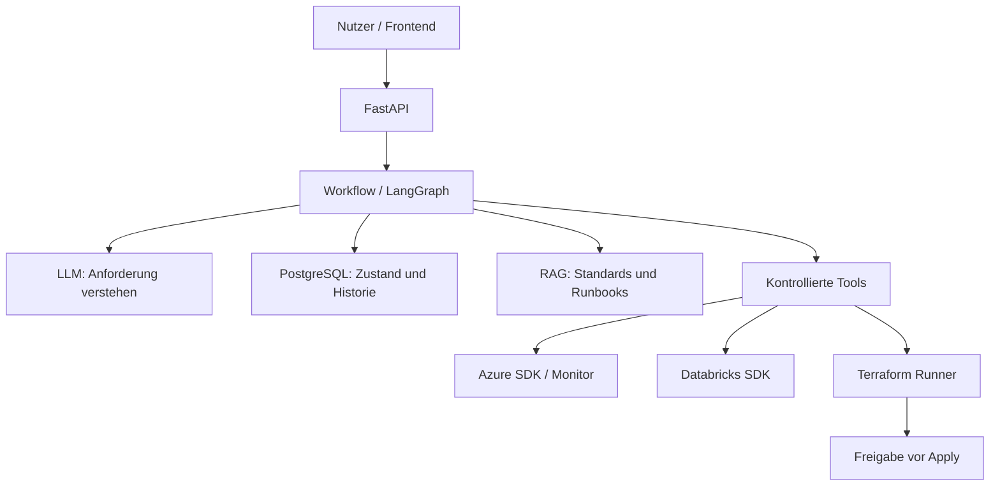
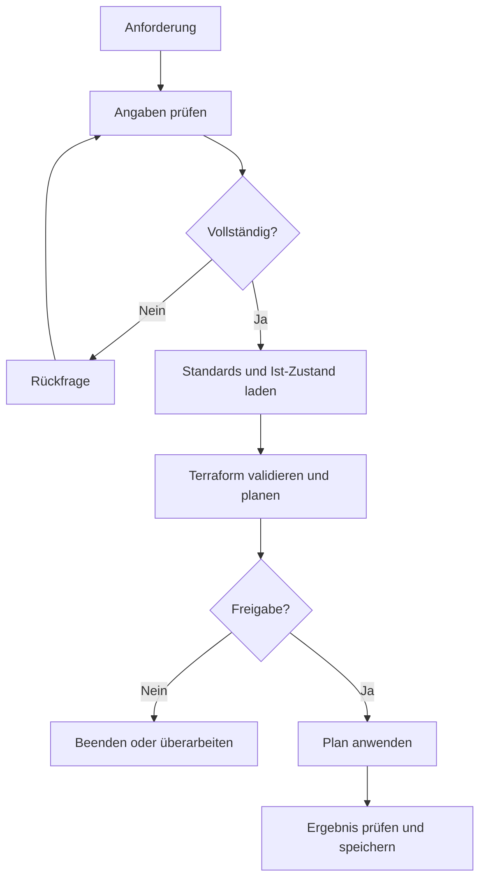

# Platform Engineering Assistant

**Ein geplanter KI-gestützter Assistent für Aufbau, Änderung und Betrieb von Azure- und Databricks-Datenplattformen.** Er übersetzt Anforderungen in nachvollziehbare technische Schritte: Umgebung prüfen, Unternehmensstandards berücksichtigen, Deployment planen, Freigabe einholen, ausführen und das Ergebnis überwachen.

> **Projektstatus:** Diese README beschreibt die Zielarchitektur und die geplante Entwicklung. Die genannten Integrationen und Workflows sind erst verfügbar, wenn sie im Repository implementiert sind. Der erste technische Meilenstein ist eine FastAPI-Anwendung mit PostgreSQL und CRUD für Plattformen.

## Welches Problem löst das Projekt?

Eine Datenplattform einzurichten oder einen Fehler zu untersuchen erfordert Informationen aus vielen Quellen: Cloud-Ressourcen, Databricks, Terraform-State, Monitoring und internen Standards. Der Assistant führt diese Informationen in einem kontrollierten Workflow zusammen. Nutzer können eine Anforderung in natürlicher Sprache formulieren und erhalten einen prüfbaren Plan. Änderungen an realer Infrastruktur erfolgen erst nach expliziter Freigabe.

**Beispiel:** „Erstelle eine Databricks-DEV-Plattform für Customer360 in West Europe.“ Der Assistant fragt fehlende Angaben ab, prüft die Zielumgebung, lädt geltende Standards, erstellt einen Terraform-Plan und zeigt die geplanten Änderungen zur Freigabe an. Anschließend kann ein berechtigter Ausführungsdienst das Deployment übernehmen und den Status dokumentieren.

## Architektur

| Komponente | Aufgabe |
| --- | --- |
| **FastAPI** | Stellt fachliche API-Endpunkte und später die Schnittstelle zum Assistant bereit. |
| **PostgreSQL** | Speichert Plattformen, Deployments, Incidents, Nutzerinteraktionen und Prozessstatus. `pgvector` ist für die spätere Dokumentensuche vorgesehen. |
| **LLM** | Interpretiert Nutzeranfragen, strukturiert Anforderungen und formuliert Ergebnisse. Es erhält nur die für den Schritt nötigen Daten. |
| **RAG** | Sucht passende Passagen aus Architekturstandards, Terraform-Dokumentation und Incident-Runbooks und liefert Quellenkontext. |
| **LangGraph** | Steuert die Schritte, Verzweigungen und Freigabepunkte des Workflows. |
| **Agent-Tools** | Bieten eng definierte Operationen zum Lesen, Planen und später Ausführen. Das LLM bekommt keine freie Shell. |
| **Azure / Databricks SDKs** | Lesen den Ist-Zustand und prüfen Ressourcen, Jobs, Logs und Berechtigungen. |
| **Terraform Runner** | Validiert Konfigurationen, erzeugt Pläne und führt freigegebene Pläne aus. |
| **Langfuse (geplant)** | Macht LLM- und Agent-Läufe für Analyse und Qualitätskontrolle nachvollziehbar; sensible Daten müssen in Traces maskiert werden. |

### Daten und Wissen

Die relationale Datenbank beantwortet Fragen wie „Welche Plattform existiert?“ und „Welches Deployment ist fehlgeschlagen?“. Die RAG-Suche beantwortet Fragen wie „Welcher Standard gilt für PROD?“ oder „Was empfiehlt das Runbook bei diesem Fehler?“. Für den aktuellen Zustand in Azure und Databricks fragt der Assistant die jeweiligen Systeme ab, gespeicherte Daten können veraltet sein.

Geplante Kernobjekte sind `users`, `platforms`, `deployments`, `incidents`, `documents` und `agent_runs`. `conversations` und `messages` halten später den Chat-Kontext fest. Ein Deployment speichert unter anderem Status, zugehörige Plattform, Planreferenz, Freigabe und Ergebnis. Es wird im regulären Assistant-Workflow intern angelegt, der Nutzer muss keine Folge von CRUD-Endpunkten selbst bedienen.

## Geplanter Ablauf: Plattform bereitstellen

1. Der Assistant erfasst Projekt, Umgebung, Region und Zielkonfiguration; fehlende Pflichtangaben werden abgefragt.
2. Er lädt gespeicherte Plattformdaten, sucht relevante Standards per RAG und prüft die tatsächlichen Azure- und Databricks-Ressourcen mit Leserechten.
3. Ein kontrollierter Runner wählt freigegebene Terraform-Module und erzeugt nach Validierung einen Plan. Der Plan zeigt auch Änderungen und mögliche Löschungen.
4. Ein berechtigter Nutzer prüft und genehmigt genau diesen Plan. Bei Änderungen am Plan ist eine neue Freigabe nötig.
5. Der Runner wendet den freigegebenen Plan an, prüft den Zielzustand und schreibt Status sowie Ergebnis in die Datenbank.

## Geplanter Ablauf: Incident untersuchen

Ein Incident kann durch einen Nutzer oder ein Monitoring-Signal entstehen. Der Assistant lädt betroffene Plattform, fehlgeschlagene Databricks-Jobläufe, Logs und jüngste Deployments. RAG ergänzt passende Runbooks. Daraus erstellt das LLM eine **begründete Diagnose mit Belegen und Handlungsvorschlägen**. Die Behebung wird nicht allein aus einer Modellvermutung ausgeführt, Änderungen durchlaufen einen eigenen kontrollierten Freigabeprozess.

## API-Konzept

Die folgenden Routen sind ein **geplanter Schnittstellenentwurf**, sie beschreiben noch keine bereits implementierte API.

| Bereich | Geplante Endpunkte | Zweck |
| --- | --- | --- |
| Plattformen | `POST /api/platforms`, `GET /api/platforms`, `GET /api/platforms/{id}`, `PUT /api/platforms/{id}`, `DELETE /api/platforms/{id}` | Stammdaten verwalten. |
| Deployments | `POST /api/platforms/{id}/deployments`, `POST /api/deployments/{id}/plan`, `POST /api/deployments/{id}/approve`, `POST /api/deployments/{id}/apply` | Änderungen planen und freigeben. |
| Incidents | `POST /api/incidents`, `GET /api/incidents`, `GET /api/incidents/{id}`, `POST /api/incidents/{id}/analyze` | Störungen erfassen und analysieren. |
| Dokumente / RAG | `POST /api/documents`, `GET /api/documents`, `POST /api/rag/search` | Wissensbasis verwalten und durchsuchen. |
| Assistant | `POST /api/assistant/chat` | Anfragen in natürlicher Sprache verarbeiten. |

CRUD liefert die fachlichen Grundfunktionen. Im späteren Nutzerablauf verwendet der Assistant dieselben Services intern. Ein Chat erzeugt also bei Bedarf selbst den passenden Plattform- oder Deployment-Datensatz.

## Identitäten und Sicherheit

- **Keine Zugangsdaten im LLM-Kontext:** Secrets und Access Tokens gehören weder in Prompts noch in Dokumente, Chat-Historie oder unmaskierte Traces.
- **Lokale Entwicklung:** Azure-CLI-Anmeldung oder eine geschützte `.env` für Testzugänge; `.env`, Terraform-State und Plan-Dateien dürfen nicht in Git eingecheckt werden.
- **Betrieb:** Ausführungsdienste authentifizieren sich bevorzugt über Managed Identity oder Workload Identity Federation. Konfiguration wie Subscription-ID, Resource Group und Workspace-URL kann in der Datenbank stehen; Berechtigungen und kurzlebige Tokens kommen aus dem Identity-System.
- **Getrennte Rechte:** Lese-Tools und Deployment-Runner erhalten nur die jeweils nötigen Rechte auf definierte Ressourcen. Databricks-Automation nutzt eine entsprechend berechtigte technische Identität.
- **Freigabe und Nachvollziehbarkeit:** `terraform apply` ist erst nach Authentifizierung, Autorisierung und Freigabe eines konkreten Plans zulässig. Plan, freigebender Nutzer und Ausführung werden protokolliert. Ein freies `terraform destroy` ist nicht als Agent-Tool vorgesehen.
- **Terraform-State:** Der produktive State liegt in einem geschützten Remote-Backend mit Locking und passenden Zugriffsrechten, nicht im Repository.

## Entwicklungsplan

| Phase | Ergebnis |
| --- | --- |
| 1. Fundament | Datenmodell, FastAPI, PostgreSQL und Platform-CRUD. |
| 2. Prozessdaten | Deployments, Incidents, Dokumente und Agent-Läufe mit Status und Historie. |
| 3. Wissen | Dokumentaufnahme, Chunking, Embeddings und RAG-Suche mit `pgvector`. |
| 4. Lese-Tools | Azure- und Databricks-Bestandsaufnahme sowie Monitoring-Abfragen. |
| 5. Deployment-Planung | Freigegebene Terraform-Module, Validierung, Plan und lesbare Zusammenfassung. |
| 6. Orchestrierung | Assistant-Workflow mit LLM, Rückfragen und Freigabeprozess. |
| 7. Ausführung und Betrieb | Freigegebenes Apply, Verifikation, Incident-Analyse und Observability. |

**Erster Meilenstein:** Platform-CRUD funktioniert mit FastAPI und PostgreSQL und kann über die automatisch generierte API-Dokumentation unter `/docs` getestet werden. Eine konkrete Startanleitung und `.env.example` folgen mit der Implementierung.
